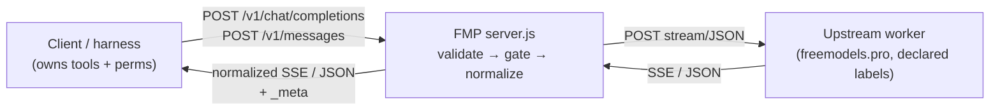

# FMP Architecture (v2.2.0)

## Components

| File | Role |
|---|---|
| `server.js` | HTTP routing, SSE, retry, bridges. No new deps. |
| `lib/config.js` | Config contract: load + validate + redact. |
| `lib/models.js` | Honest alias catalog (single source). |
| `lib/tools.js` | Tool transport: validate, normalize, emit. |
| `lib/security.js` | Redaction, auth, rate limit, sanitized errors. |
| `bin/fmp.js` | CLI: doctor/health/models/verify/config. |
| `test/` | Fixture upstream + 31 contract/security/tool tests. |

## Request lifecycle

1. Router assigns request id (`x-request-id` in, or generated).
2. Auth gate (non-health only, when keys configured) → 401 otherwise.
3. Route gate (`FMP_ENABLE_*`) → 404 when disabled.
4. Global rate limit (`FMP_RATE_LIMIT_RPM`) → 429 + `retry-after`.
5. Model resolution: explicit required (400), known (404 otherwise),
   enabled (503 when killed/disabled). No silent fallback, ever.
6. Tool schema validation (400 on malformed) — before upstream.
7. Upstream SSE with retry (only while nothing emitted) + JSON
   fallback; dedupe avoids Frankenstein merges.
8. Native-schema emission with `_meta` (alias, route, identities).
9. Errors sanitized: status + request id, no upstream detail.

## State

In-memory only: request counters, tier windows, rate-limit buckets.
No disk writes except optional trace file (redacted). Graceful
shutdown drains in-flight streams (15s cap) and exits 0.
